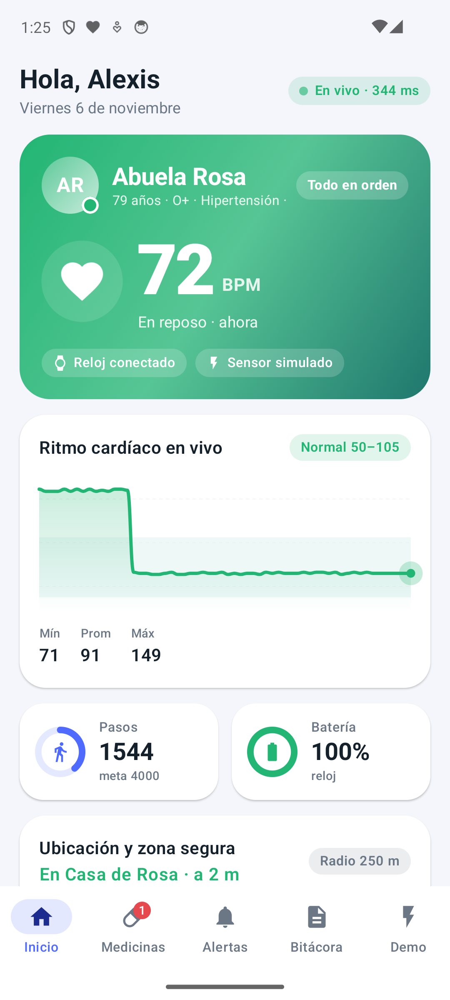
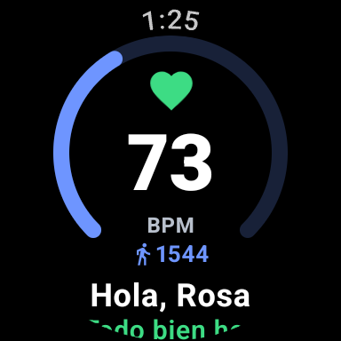

# VitaLink · Asistencia compartida y monitoreo en tiempo real

Dos apps nativas en Kotlin que cuidan a una persona mayor entre toda la familia:

| Módulo | Para quién | UI |
|---|---|---|
| `wear/` | El paciente (Wear OS) | Compose for Wear OS (Material 3), alto contraste, botones grandes |
| `mobile/` | Familiares y cuidadores (Android) | Jetpack Compose + Material 3 |
| `core/` | Compartido | Modelos, sincronización Supabase Realtime, motor de signos vitales, detección de caídas/anomalías, caché offline |

Ambas apps se conectan **directo a Supabase** (sin Bluetooth ni Data Layer): cada una funciona sola y, juntas, se reflejan al instante.

 

---

## 1. Requisitos

- Android SDK en `~/Android/Sdk` con `platform-tools`, `emulator`, `cmdline-tools/latest`, `platforms;android-37.0` y las imágenes:
  - `system-images;android-34;google_apis;x86_64` (teléfono)
  - `system-images;android-34;android-wear;x86_64` (reloj)
- **JDK 17** para Gradle (el JDK 27 del sistema es demasiado nuevo para AGP 9). Gradle ya descargó uno en `~/.gradle/jdks/`.
- Internet en el host (los emuladores salen por NAT a Supabase).

Variables para cada terminal:

```bash
export ANDROID_HOME=~/Android/Sdk
export PATH=$ANDROID_HOME/platform-tools:$ANDROID_HOME/emulator:$ANDROID_HOME/cmdline-tools/latest/bin:$PATH
export JAVA_HOME=~/.gradle/jdks/eclipse_adoptium-17-amd64-linux.2   # o cualquier JDK 17/21
cd ~/Proyectos/VitaLink
```

## 2. Emuladores

### 2.1 Verificar si ya están corriendo

```bash
adb devices -l
# emulator-5554  device product:sdk_gphone64_x86_64 ...   <- teléfono
# emulator-5556  device product:sdk_gwear_x86_64 ...      <- reloj
```

### 2.2 Crear los AVD (sólo si no existen)

```bash
sdkmanager "system-images;android-34;google_apis;x86_64" "system-images;android-34;android-wear;x86_64"
avdmanager create avd -n Pixel_Phone  -k "system-images;android-34;google_apis;x86_64"  -d pixel_6 --force
avdmanager create avd -n WearOS_Round -k "system-images;android-34;android-wear;x86_64" -d wearos_small_round --force
```

> El AVD `WearOS_Round` existente estaba definido como **cuadrado** (`wearos_square`, 360×360). Se convirtió a
> redondo 384×384 y se activó el sensor virtual de pulso. Respaldo del original:
> `~/.android/avd/WearOS_Round.avd/config.ini.bak-vitalink`.

### 2.3 Arrancarlos en segundo plano

Usa `setsid` para que sigan vivos aunque cierres la terminal:

```bash
setsid nohup emulator -avd Pixel_Phone  -no-boot-anim > /tmp/phone_emu.log 2>&1 < /dev/null &
setsid nohup emulator -avd WearOS_Round -no-boot-anim > /tmp/wear_emu.log  2>&1 < /dev/null &

# esperar a que terminen de arrancar
for s in emulator-5554 emulator-5556; do adb -s $s wait-for-device; \
  until [ "$(adb -s $s shell getprop sys.boot_completed | tr -d '\r')" = "1" ]; do sleep 2; done; echo "$s listo"; done
```

Si cambias la configuración del AVD, apágalo con `adb -s emulator-5556 emu kill`, **espera** a que el proceso
termine (`pgrep -af qemu`) y arráncalo con `-no-snapshot-load`.

Los emuladores **no necesitan cuenta de Google**. Prueba la salida a internet con:

```bash
adb -s emulator-5554 shell ping -c1 fygxsmtfwucgwweismkw.supabase.co
adb -s emulator-5556 shell ping -c1 fygxsmtfwucgwweismkw.supabase.co
```

## 3. Compilar, instalar y abrir (un solo comando)

```bash
scripts/deploy.sh            # compila, instala, concede permisos y abre ambas apps
scripts/deploy.sh --no-build # sólo reinstala los APK ya compilados
```

`deploy.sh` detecta solo qué emulador es teléfono (`sdk_gphone`) y cuál reloj (`sdk_gwear`).

### Paso a paso equivalente

```bash
./gradlew assembleDebug
./gradlew :core:testDebugUnitTest          # 9 pruebas: caídas, anomalías, motor, geocerca, fechas

adb -s emulator-5554 install -r mobile/build/outputs/apk/debug/mobile-debug.apk
adb -s emulator-5556 install -r wear/build/outputs/apk/debug/wear-debug.apk

# permisos (sin diálogos)
adb -s emulator-5554 shell pm grant com.vitalink.mobile android.permission.POST_NOTIFICATIONS
adb -s emulator-5556 shell pm grant com.vitalink.wear android.permission.BODY_SENSORS
adb -s emulator-5556 shell pm grant com.vitalink.wear android.permission.ACTIVITY_RECOGNITION
adb -s emulator-5556 shell pm grant com.vitalink.wear android.permission.POST_NOTIFICATIONS

adb -s emulator-5554 shell am start -n com.vitalink.mobile/.MainActivity
adb -s emulator-5556 shell am start -n com.vitalink.wear/.MainActivity
```

No hace falta `adb forward` ni `ACCESS_LOCAL_NETWORK`: no hay puente TCP local, todo pasa por Supabase.

## 4. Verificar la conexión en vivo

```bash
adb -s emulator-5554 logcat -s VitaLink-Sync AndroidRuntime
adb -s emulator-5556 logcat -s VitaLink-Sync VitaLink-Watch AndroidRuntime
```

Debes ver en **ambos**:

```
VitaLink-Sync: Datos sincronizados: 4 medicinas, 6 tomas, ...
VitaLink-Sync: Realtime SUSCRITO al canal care-<patient_id> (phone|watch)
```

En el teléfono la píldora superior muestra **"En vivo · N ms"** (latencia real del último evento).

## 5. Cuentas, círculos y vinculación del reloj

Nadie ve nada sin sesión. Cada paciente tiene un **círculo de cuidado**: sólo sus miembros pueden leer o escribir sus
datos y escuchar su canal en vivo.

1. **Teléfono → Crear cuenta** (nombre, correo, contraseña de 8+). No se pide confirmar el correo: la cuenta queda lista al instante.
   Cuenta de demo ya creada: `alexis.vitalink@gmail.com` / `Vitalink2026`.
2. **Registrar a mi familiar**: crea al paciente (apodo, edad, zona segura, "Cargar tratamiento de ejemplo") y tú quedas como administrador.
3. **Invitar a la familia**: toca tu avatar arriba a la derecha → *Código para invitar a la familia* (6 dígitos, botón Compartir).
   Otro familiar crea su cuenta → **Tengo un código de invitación**.
4. **Vincular el reloj**: el reloj sin vincular muestra un código de 6 dígitos. En el teléfono: avatar → *Reloj del paciente* →
   escribe el código → **Vincular**. En ~3 s el reloj entra con su propia cuenta, limitada a ese paciente.
5. La sesión se guarda en ambos dispositivos: al reabrir la app (o reiniciar el emulador) vuelven solos a su círculo.
   *Cambiar de círculo* y *Cerrar sesión* están en el mismo menú del avatar; el reloj se desvincula desde **Simulación**.

Protecciones: tras 10 códigos incorrectos (invitación o reloj) en una hora, la cuenta queda bloqueada para códigos durante
esa hora; el código del reloj vence a los 10 min.

Comprobar todo el modelo de seguridad contra la nube (crea cuentas temporales `prueba.*@gmail.com`):

```bash
scripts/auth-smoke-test.sh   # 18 comprobaciones: registro, aislamiento, invitaciones, límite de intentos, reloj
```

## 6. Guion de demo (lo que se probó de punta a punta)

Ya dentro del círculo, usa la pestaña **Demo** (teléfono) o el botón **Simulación** (reloj). Los botones de demo funcionan
igual que siempre, ahora por el canal privado del círculo.

| Escenario | Qué hacer | Qué pasa |
|---|---|---|
| Medicina colaborativa | Demo → *Hora de medicamento* → Losartán | El reloj vibra y muestra "Hora de tu medicina". **YA LA TOMÉ** en el reloj marca la toma como tomada en todos los teléfonos ("Confirmó Abuela Rosa desde el reloj"). Si la confirma un familiar, el reloj lo dice ("Mariana confirmó tu …"). Gana el primero que confirme. |
| Taquicardia | Demo → **Taquicardia** | Orden por Realtime Broadcast → el reloj sube de ~72 a ~148 BPM en vivo. A los 4 s sostenidos el reloj crea la alerta y el teléfono abre la pantalla roja de emergencia. |
| Yo atiendo | En el teléfono: elige ETA → **YO ATIENDO LA EMERGENCIA** | El reloj cambia al instante a verde: "Alexis va en camino · llega en ~10 min". Los demás teléfonos ven quién la atiende. |
| Estoy bien | En el reloj: **ESTOY BIEN** | La alerta se cierra en todos los dispositivos y la bitácora lo registra. |
| Caída | Demo → **Caída** (o una caída real por acelerómetro) | El reloj inicia una cuenta regresiva de 12 s ("¿Te caíste?"); el teléfono muestra la misma cuenta en un banner. Si no se cancela, se envía la alerta. |
| SOS | Reloj → botón rojo **SOS** | Cuenta regresiva de 5 s con **ESTOY BIEN** para cancelar. Cancelar avisa a la familia que fue falsa alarma. |
| Geocerca | Demo → **Sale de la zona** | El paciente se aleja de casa; al cruzar 250 m se alerta y el radar del panel muestra el punto fuera de la zona. **Normalizar** lo regresa. |
| Notas | Bitácora → escribe una nota | Aparece al instante en los demás teléfonos y como mensaje en el reloj. |
| Sin reloj | Detén la app del reloj y usa Demo | El teléfono activa el **reloj virtual** (mismo motor de signos) y publica signos/alertas; se apaga solo cuando vuelve el reloj real. |
| Sin red | `adb -s emulator-5554 shell svc wifi disable; adb -s emulator-5554 shell svc data disable` | La app abre con la caché local, las acciones quedan "Pendiente de envío" y se envían solas al volver: `svc wifi enable; svc data enable`. |

### Simular a otro familiar desde la terminal

Con la sesión de un miembro del círculo (la clave anon sola ya no ve nada):

```bash
source <(grep -E "^SUPABASE_(URL|KEY)=" supabase.properties | sed 's/^/export /')
TOKEN=$(curl -s -X POST "$SUPABASE_URL/auth/v1/token?grant_type=password" -H "apikey: $SUPABASE_KEY" \
  -H "Content-Type: application/json" -d '{"email":"alexis.vitalink@gmail.com","password":"Vitalink2026"}' \
  | python3 -c "import sys,json; print(json.load(sys.stdin)['access_token'])")
# próxima toma pendiente
curl -s "$SUPABASE_URL/rest/v1/medication_doses?select=id&status=eq.pending&order=scheduled_for.asc&limit=1" \
  -H "apikey: $SUPABASE_KEY" -H "Authorization: Bearer $TOKEN"
# confirmarla (sólo gana si sigue pendiente)
curl -s -X PATCH "$SUPABASE_URL/rest/v1/medication_doses?id=eq.<ID>&status=in.(pending,snoozed)" \
  -H "apikey: $SUPABASE_KEY" -H "Authorization: Bearer $TOKEN" -H "Content-Type: application/json" \
  -H "Prefer: return=representation" -d '{"status":"taken","confirmed_by":"Mariana","confirmed_device":"phone"}'
```

### Tocar la UI desde la terminal

Las apps exponen sus `testTag` como `resource-id`, así que se pueden automatizar con `uiautomator`:

```bash
scripts/tap.sh emulator-5554 auth_email        # auth_tab_login, auth_tab_register, auth_name, auth_password, auth_submit
scripts/tap.sh emulator-5554 open_circle       # menú del círculo: invite_code, watch_code_input, watch_code_submit, sheet_sign_out
scripts/tap.sh emulator-5554 tab_Demo          # pestañas: tab_Home, tab_Meds, tab_Alerts, tab_Log, tab_Demo
scripts/tap.sh emulator-5554 sim_tachycardia   # sim_fall, sim_sos, sim_leave_zone, sim_normal, ...
scripts/tap.sh emulator-5554 ack_button        # "Yo atiendo"; luego resolve_button
scripts/tap.sh emulator-5556 watch_sos         # watch_cancel, watch_take, watch_snooze, watch_im_ok
adb -s emulator-5556 exec-out screencap -p > reloj.png
```

## 7. Arquitectura

```
core/
  model/Models.kt          Tablas + mensajes Broadcast (VitalsPulse, CountdownSignal, SimCommand, DevicePing)
  data/Account.kt          Registro/inicio de sesión (Supabase Auth), círculos, invitaciones, vinculación del reloj
  data/CareRepository.kt   Carga inicial, canal Realtime privado por paciente, supervisor de reconexión,
                           escrituras optimistas, "gana el primero" y bandeja de salida
  data/LocalStore.kt       Caché JSON y outbox por paciente (abre sin red), identidad y círculo seleccionado
  engine/VitalsEngine.kt   Pulso/pasos/batería/GPS realistas con escenarios graduales (sensor real si existe)
  engine/AnomalyDetector   Taquicardia, bradicardia, geocerca, batería (condición sostenida + rearme)
  engine/FallDetector      Caída libre + impacto por acelerómetro
mobile/                    Login/registro, selector de círculos, panel, Medicinas, Alertas, Bitácora, Demo,
                           menú del círculo (invitar, vincular reloj, cerrar sesión), overlay de emergencia,
                           notificaciones, servicio en primer plano (dataSync), reloj virtual
wear/                      Pantalla de vinculación por código, WatchBrain (sensores, cuentas regresivas,
                           recordatorios) + UI de alto contraste
supabase/functions/        sign-up (cuentas sin confirmación por correo) y device-pairing (código del reloj)
```

**Realtime** — un canal **privado** `care-<patient_id>` por paciente (sólo miembros, validado con políticas en `realtime.messages`):

- *Postgres Changes* (estado durable): `alerts`, `medication_doses`, `medications`, `care_log`, `vitals_live`, `caregivers`, `patients`.
- *Broadcast* (efímero, sin tocar la BD): `vitals` (pulso a 1 Hz), `countdown` (cuenta regresiva del reloj), `sim` (órdenes del simulador), `ping` (presencia de dispositivos).

El reloj persiste `vitals_live` cada 3 s y `vitals_history` cada 10 s; el teléfono pinta a 1 Hz desde Broadcast.

**Resiliencia** — al reconectar se recarga todo y se vacía la bandeja de salida; las inserciones usan UUID del cliente
(reintentos idempotentes); las confirmaciones usan `UPDATE … WHERE status IN (…)` para que sólo gane el primero.

## 8. Base de datos (Supabase)

Proyecto **VitaLink** (`fygxsmtfwucgwweismkw`, us-west-1). Credenciales en `supabase.properties` (ignorado por git; plantilla en `supabase.properties.example`); se inyectan como `BuildConfig` del módulo `core`.

Las migraciones aplicadas están en `supabase/migrations/` (en orden). Para otro proyecto: ejecútalas en el SQL Editor
(o `supabase db push`), despliega las funciones y pon su URL y anon key en `supabase.properties`:

```bash
supabase functions deploy sign-up --no-verify-jwt
supabase functions deploy device-pairing --no-verify-jwt
```

| Tabla | Uso |
|---|---|
| `patients` | Cada paciente: casa, radio de zona segura, zona horaria, `invite_code` de 6 dígitos |
| `caregivers` | Miembros del círculo: cuenta (`user_id`), parentesco, color y rol `owner` / `caregiver` / `device` (reloj) |
| `device_pairings` | Códigos de vinculación de relojes (sólo accesible desde la función `device-pairing`) |
| `code_attempts` | Intentos fallidos de códigos, para el límite de 10 por hora |
| `vitals_live` / `vitals_history` | Último estado y muestras históricas |
| `medications` / `medication_doses` | Tratamientos y tomas del día (`ensure_doses()` las genera) |
| `alerts` | SOS, caída, taquicardia, bradicardia, geocerca, batería, con quién atiende y ETA |
| `care_log` | Bitácora; triggers la llenan solos al confirmar tomas o cambiar alertas |

Extras: un job de `pg_cron` (cada minuto) marca como "no confirmada" una toma con más de 60 min de atraso y genera las tomas del día en curso.

**Seguridad:** RLS por círculo con `is_member(patient_id)`; el rol `anon` no ve ni escribe nada. Las altas pasan por
funciones (`create_patient`, `join_circle`, `claim_device`) que validan la sesión y la pertenencia. Las funciones en la
nube usan la clave de servicio, que nunca sale del servidor. Pendiente opcional: activar *Leaked password protection*
en Authentication → Settings del panel de Supabase.

Limpiar alertas y bitácora de un círculo (SQL Editor o MCP):

```sql
delete from alerts; delete from care_log where kind <> 'system';
```

Borrar cuentas de prueba creadas por `scripts/auth-smoke-test.sh`:

```sql
delete from patients where id in (select c.patient_id from caregivers c join auth.users u on u.id = c.user_id
  where u.email like 'prueba.%@gmail.com');
delete from auth.users where email like 'prueba.%@gmail.com'
  or (email like 'reloj-%@watch.vitalink.app' and id not in (select user_id from caregivers));
```

## 9. Problemas comunes

| Síntoma | Solución |
|---|---|
| `Unsupported class file major version` / Gradle no arranca | Usa JDK 17: `export JAVA_HOME=~/.gradle/jdks/eclipse_adoptium-17-amd64-linux.2` |
| Los emuladores se cierran al cerrar la terminal | Lánzalos con `setsid nohup … &` |
| `Running multiple emulators with the same AVD` | El anterior aún se está cerrando: espera a que `pgrep -af qemu` no lo muestre |
| La píldora dice "Sin conexión" | Revisa internet del emulador (`ping` arriba); la app reintenta sola cada 2–20 s |
| El reloj se queda en "Vincula tu reloj" | El código vence a los 10 min: toca **Nuevo código**; revisa que el teléfono muestre "Listo" |
| "Demasiados intentos con códigos incorrectos" | Espera una hora o borra las filas de `code_attempts` de esa cuenta |
| `uiautomator` no encuentra un elemento | Hay una animación o un overlay encima; reintenta o usa `adb shell input tap X Y` |
